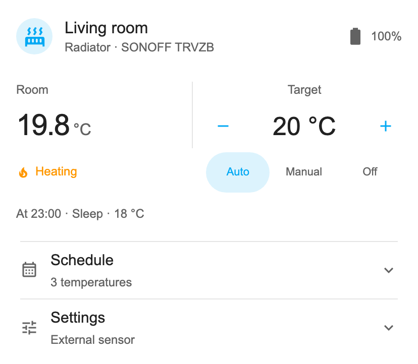
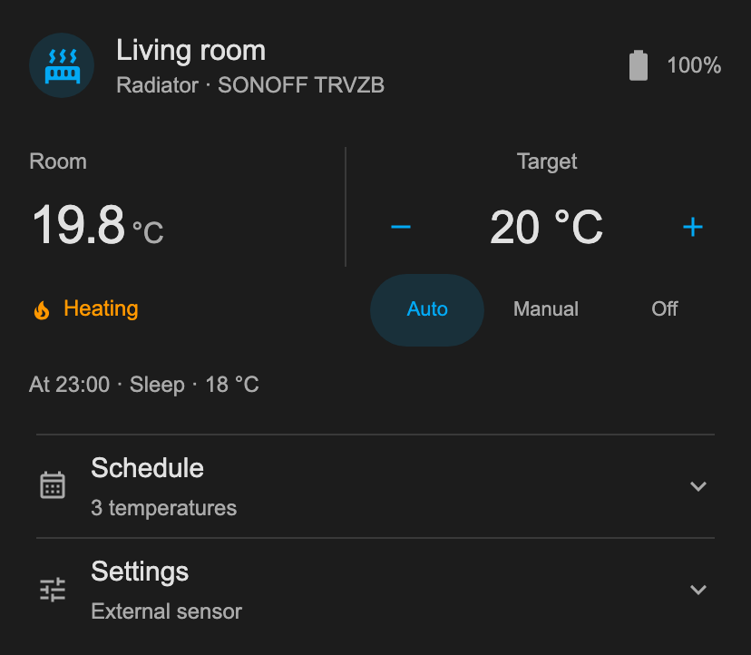
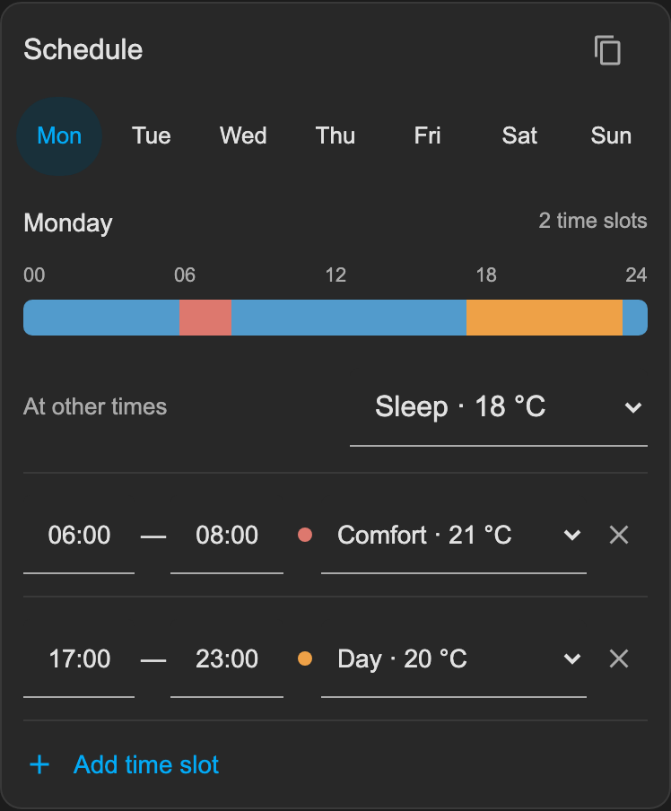
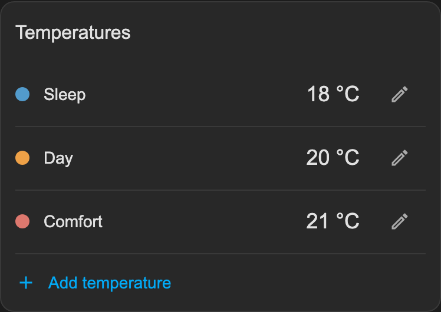

# TRVZB Control Card

A compact Home Assistant card for SONOFF TRVZB radiator valves using Zigbee2MQTT. Control the temperature and mode, see battery and heating status, and edit the valve's weekly schedule in one place.

 

Set up your own temperature presets and assign them to time slots throughout the week. Schedules run on the valve, including when Home Assistant is offline.

 

## Installation

### HACS

1. In HACS, open **⋮ → Custom repositories**.
2. Add `https://github.com/enikesha/trvzb-control-card` and select **Dashboard** as the category.
3. Find **TRVZB Control Card**, download it, and reload Home Assistant in your browser or app.

### Manual

1. Download `trvzb-control-card.js` from a release.
2. Copy it to `/config/www/trvzb-control-card.js`. If you need to create `www`, place it next to `configuration.yaml` and restart Home Assistant once.
3. Open **Settings → Dashboards → ⋮ → Resources → Add resource**. If **Resources** is hidden, enable **Advanced mode** in your user profile.
4. Set **URL** to `/local/trvzb-control-card.js?v=0.3.0` and **Resource type** to **JavaScript module**. Save and reload Home Assistant in your browser or app.

## Add the card

Edit your dashboard, select **Add card → Manual**, and paste:

```yaml
type: custom:trvzb-control-card
entity: climate.example_radiator
name: Radiator
dashboard: dashboard-heating
card_id: example-radiator
```

Replace these values:

| Option | Value |
| --- | --- |
| `entity` | Your radiator's climate entity ID. |
| `name` | The title shown on the card. Optional. |
| `dashboard` | The first part of your dashboard's URL after the hostname. For `/dashboard-heating/living-room`, use `dashboard-heating`. |
| `card_id` | A name that identifies this card within the dashboard. Choose a different one for each radiator card. |

The schedule editor currently requires an administrator account and a dashboard created and edited through Home Assistant. It cannot save changes on dashboards loaded from YAML files. Other users can use the temperature and mode controls.

See [configuration and troubleshooting](docs/CONFIGURATION.md) for renamed entities, optional settings, and loading problems.

## Using the card

Use **− / +** to adjust the target temperature. Click the radiator's title to open Home Assistant's entity details and history. Open **Settings** for child lock, open-window detection, temperature source, and frost protection.

| Mode | Behavior |
| --- | --- |
| **Auto** | Follows the weekly schedule. A temperature adjustment lasts until the next scheduled temperature change. **Resume** cancels the adjustment. |
| **Manual** | Holds the selected temperature. **Resume** switches back to Auto. |
| **Off** | Turns heating off while retaining frost protection. |

Temporary adjustments in Auto require a scheduled temperature change within the next 24 hours. The valve's timer has one-minute precision and continues running after you close the app.

The interface supports English and Russian and uses your Home Assistant theme. Time is shown in 24-hour format unless you explicitly select a 12-hour format in your Home Assistant profile.

### Schedule

1. Open **Schedule** and add the temperature presets you want, such as Sleep, Away, and Comfort.
2. Choose a day and set **At other times** to its default temperature.
3. Add time slots and select a temperature for each.
4. Use the copy button to apply that day's schedule to other days, then select **Save**.

The valve allows up to six temperature transitions per day, including midnight, and temperatures from 4 to 35 °C in 0.5 °C steps. If a save fails, reload the card and check the days you edited before retrying.

## Updating

**HACS:** install the update in HACS, then reload Home Assistant in your browser or app.

**Manual:** replace `/config/www/trvzb-control-card.js` with the file from the new release. In **Settings → Dashboards → ⋮ → Resources**, edit this card's entry and replace `0.3.0` after `?v=` with the version you downloaded. Save and reload Home Assistant in your browser or app.

If you switch from manual installation to HACS, remove the `/local/trvzb-control-card.js` entry from **Resources** after installing through HACS.

## Compatibility

Supports SONOFF TRVZB through Zigbee2MQTT. Tested with Home Assistant 2026.4.1, Zigbee2MQTT 2.13.0, and TRVZB firmware 1.4.4. ZHA and other valve models are not supported.

## Development

[Development guide](docs/DEVELOPMENT.md) · [Changelog](CHANGELOG.md) · [MIT license](LICENSE)
